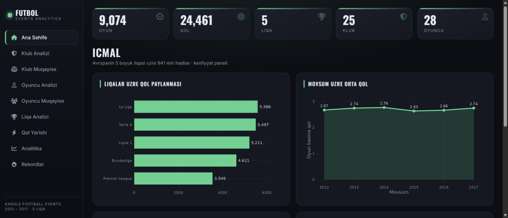

# Football Events Dashboard — Ishe salma telimati



## 1. Qovluq strukturu
`app.R` faylini **butun `.rds` fayllarinla eyni qovluga** qoy:

```
futbol-dashboard/
├── app.R                      <- bu fayl
├── club_summary_top5.rds
├── club_colors.rds
├── club_logos.rds
├── club_season_trend.rds
├── club_style_profile.rds
├── club_home_advantage.rds
├── clean_sheets.rds
├── player_summary_top5.rds
├── player_home_away.rds
├── player_radar_profile.rds
├── player_match_goals.rds
├── league_season_summary.rds
├── red_card_impact.rds
├── biggest_comebacks.rds
├── highest_scoring_games.rds
└── www/                       <- istege gore
    └── stadium.jpg            <- solgun stadion fonu (opsional)
```

## 2. Paketler (bir defe)
```r
install.packages(c("shiny","ggplot2","dplyr","tidyr","scales","stringr","httr"))
```

## 3. Ishe sal
RStudio-da `app.R`-i ac → sag yuxarida **"Run App"** duymesi.
Ve ya konsolda:
```r
shiny::runApp()
```

## 4. Nece ishleyir
- **Sol panel** — 7 bolme arasinda naviqasiya.
- **Yuxari KPI kartlari** — umumi statistika (hemishe gorunur).
- **Klub secende** butun panelin aksent rengi o klubun brend renginе deyisir
  (Bayern → qirmizi, Dortmund → sari, Barcelona → goy-al ...). Bu, dashboard-un
  imza xususiyyetidir.
- **Klub loqolari** `club_logos.rds`-den birbasha gelir; tapilmayan klublar ucun
  klub renginde initial-badge gosterilir.
- **Oyuncu sekilleri** Wikipedia-dan avtomatik cekilir (internet lazimdir).
  Tapilmasa oyuncunun bas herfi ile placeholder gosterilir.

## 5. Opsional: stadion fonu
`www/` qovlugu yarat, icine `stadium.jpg` at — yuxarida solgun stadion fonu
avtomatik gorunecek. Fayl yoxdursa problem deyil, sade projektor-isigi effekti qalir.

## 6. Qeydler
- ggplot etiketleri Windows render problemini onlemek ucun ASCII-dir
  (Movsum, Netice, Hucum ...). UI metnleri tam Azerbaycan herflerindedir.
- Butun aqreqasiyalar hazir `.rds`-lerden oxunur — 941K setir her defe yeniden
  emal edilmir, ona gore app tez acilir.

## Canlı tətbiq
[Futbol Analitikası](https://jrashid.shinyapps.io/for_shiny/)

Mənbə: [Football Events](https://www.kaggle.com/datasets/secareanualin/football-events). Tətbiq repodakı hazır qruplaşdırılmış fayllarla işləyir.

